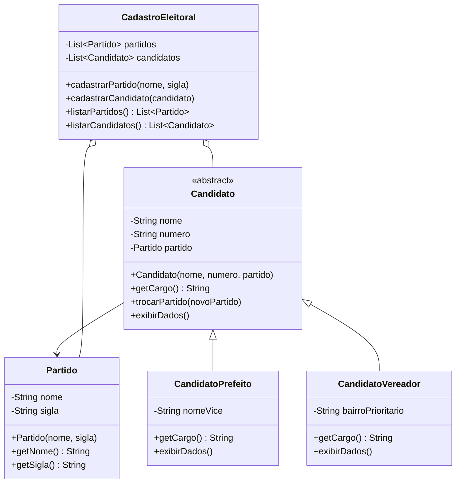

# Cadastro Eleitoral em Java

Projeto didático de Programação Orientada a Objetos usado para estudar classe, objeto, construtor, encapsulamento, associação, herança, abstração, sobrescrita e polimorfismo.

Todos os partidos e candidatos cadastrados durante os testes devem ser fictícios.

## O que o programa faz

O menu permite:

1. cadastrar partidos;
2. listar partidos;
3. cadastrar candidatos a prefeito ou vereador;
4. listar candidatos;
5. trocar o partido de um candidato;
6. encerrar o programa.

Os dados permanecem apenas na memória enquanto o programa está executando.

## Estrutura

```text
Cadastro_Eleitoral_POO/
├── src/
│   ├── Main.java
│   ├── CadastroEleitoral.java
│   ├── Partido.java
│   ├── Candidato.java
│   ├── CandidatoPrefeito.java
│   └── CandidatoVereador.java
├── docs/
│   └── GUIA_DE_ESTUDO.md
├── .gitignore
└── README.md
```

## Relações entre as classes



## Compilação e execução

Na pasta principal do projeto:

```bash
javac -encoding UTF-8 -d out src/*.java
java -cp out Main
```

O projeto usa recursos compatíveis com Java 17 ou superior.

## Exemplo de herança

```java
public class CandidatoPrefeito extends Candidato {
    // A classe recebe os comportamentos acessíveis de Candidato
    // e acrescenta o atributo nomeVice.
}
```

`CandidatoPrefeito` é uma classe especializada de `Candidato`. O relacionamento entre as duas classes é declarado com `extends`.

## Exemplo de instanciação

```java
Candidato candidato = new CandidatoPrefeito(
    "Ana Ventura",
    "41",
    partido,
    "Rui Campos"
);
```

`new CandidatoPrefeito(...)` cria um objeto concreto. A variável `candidato`, do tipo `Candidato`, guarda a referência para esse objeto.

## Onde aparece o polimorfismo

`CadastroEleitoral` guarda objetos diferentes em uma lista do tipo comum:

```java
private final List<Candidato> candidatos;
```

Na listagem:

```java
for (Candidato candidato : candidatos) {
    candidato.exibirDados();
}
```

O Java executa a versão de `exibirDados()` correspondente à classe real do objeto: `CandidatoPrefeito` ou `CandidatoVereador`.

## Regras importantes

- nome, número e partido são obrigatórios;
- o número deve possuir somente dígitos;
- candidato a prefeito usa número com dois dígitos;
- candidato a vereador usa número com cinco dígitos;
- siglas de partidos não podem se repetir;
- números de candidatos não podem se repetir;
- um candidato não pode trocar para o mesmo objeto `Partido` ao qual já está associado;
- as listas retornadas por `CadastroEleitoral` são cópias não modificáveis.

## Material de estudo

Leia [docs/GUIA_DE_ESTUDO.md](docs/GUIA_DE_ESTUDO.md) depois de executar todas as opções do menu.

### Documentação detalhada do código

1. [O problema e a execução do programa](docs/documentacao/01-problema-e-execucao.md)
2. [A classe Partido](docs/documentacao/02-classe-partido.md)
3. [A classe abstrata Candidato](docs/documentacao/03-classe-candidato.md)
4. [Herança e sobrescrita nas subclasses](docs/documentacao/04-heranca-e-sobrescrita.md)
5. [Coleções e encapsulamento em CadastroEleitoral](docs/documentacao/05-colecoes-e-encapsulamento.md)
6. [Main e a interação entre objetos](docs/documentacao/06-main-e-interacao.md)
7. [Cadastro dos dois tipos de candidatos](docs/documentacao/07-cadastro-dos-candidatos.md)
8. [Polimorfismo durante a listagem](docs/documentacao/08-polimorfismo-na-listagem.md)
9. [Atividades práticas de modificação](docs/documentacao/09-atividades-praticas.md)
