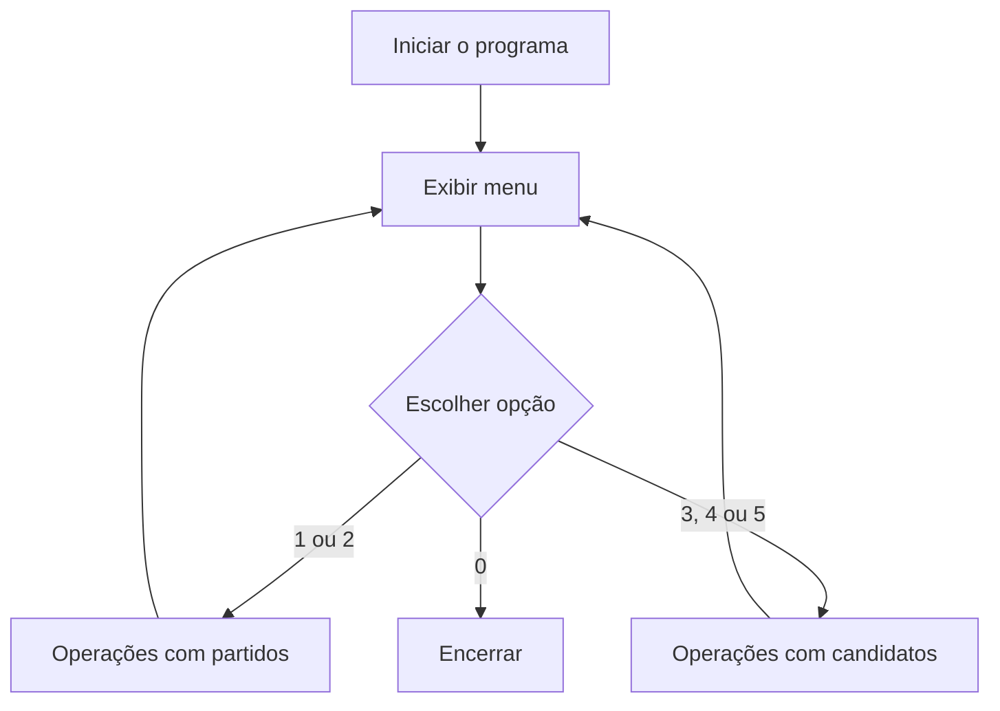

# 1. O problema e a execução do programa

## Objetivo do projeto

O projeto representa um cadastro eleitoral simplificado executado no terminal. Seu objetivo não é reproduzir um sistema eleitoral real, mas fornecer um exemplo pequeno e completo para o estudo de Programação Orientada a Objetos em Java.

Todos os nomes, partidos e números utilizados durante os testes devem ser fictícios.

O programa permite:

1. cadastrar partidos;
2. listar os partidos cadastrados;
3. cadastrar candidatos a prefeito ou vereador;
4. listar os candidatos;
5. trocar o partido de um candidato;
6. encerrar a execução.

Os dados são mantidos somente na memória. Ao encerrar o programa, os cadastros realizados são perdidos, pois o projeto ainda não utiliza arquivos nem banco de dados.

## Classes que compõem a solução

| Classe | Responsabilidade principal |
|---|---|
| `Main` | Exibir o menu, ler as opções e coordenar as operações |
| `CadastroEleitoral` | Armazenar partidos e candidatos e aplicar as regras de cadastro |
| `Partido` | Representar um partido por nome e sigla |
| `Candidato` | Reunir os dados e comportamentos comuns aos candidatos |
| `CandidatoPrefeito` | Representar um candidato a prefeito e seu vice |
| `CandidatoVereador` | Representar um candidato a vereador e seu bairro prioritário |

## Fluxo geral



O método `main` cria um objeto `CadastroEleitoral`. Esse objeto permanece disponível durante toda a execução e guarda as listas de partidos e candidatos.

```java
Scanner scanner = new Scanner(System.in);
CadastroEleitoral cadastro = new CadastroEleitoral();
```

## Compilação

Na pasta principal do projeto, execute:

```bash
javac -encoding UTF-8 -d out src/*.java
```

Esse comando:

- localiza os arquivos `.java` dentro de `src`;
- compila as classes;
- grava os arquivos `.class` na pasta `out`;
- utiliza UTF-8 para preservar os caracteres acentuados.

Se a compilação terminar sem mensagens de erro, execute:

```bash
java -cp out Main
```

`-cp out` informa que as classes compiladas estão na pasta `out`. `Main` é a classe que possui o método de entrada da aplicação.

## Primeiro teste

Uma sequência inicial pode ser:

1. escolher `1` e cadastrar o partido fictício `Partido Horizonte`, sigla `PH`;
2. escolher `2` e verificar a listagem;
3. escolher `3` e cadastrar um candidato;
4. escolher `4` e observar os dados apresentados;
5. escolher `0` para encerrar.

Antes de cadastrar um candidato, é necessário cadastrar pelo menos um partido. Essa dependência existe porque todo candidato precisa estar associado a um objeto `Partido`.

## O que observar durante a execução

- o menu volta a ser apresentado após cada operação;
- entradas inválidas produzem mensagens de erro;
- siglas são convertidas para letras maiúsculas;
- candidatos a prefeito usam dois dígitos;
- candidatos a vereador usam cinco dígitos;
- números de candidatos e siglas de partidos não podem se repetir.

## Verificação de aprendizagem

1. Qual classe inicia a execução?
2. Qual objeto guarda os cadastros enquanto o programa está aberto?
3. Por que é necessário cadastrar um partido antes de um candidato?
4. O que acontece com os dados após o encerramento?
5. Qual é a diferença entre compilar e executar o programa?

