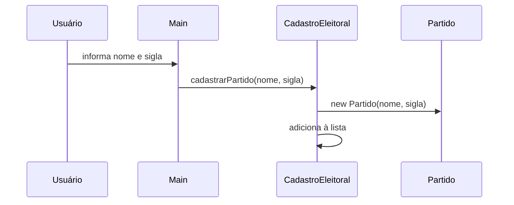

# 6. A classe `Main` e a interação entre objetos

`Main` é o ponto de entrada e a camada de interação pelo terminal. Ela cria objetos, lê dados, chama métodos das demais classes e apresenta os resultados ao usuário.

## Ponto de entrada

```java
public static void main(String[] args) {
    Scanner scanner = new Scanner(System.in);
    CadastroEleitoral cadastro = new CadastroEleitoral();
    String opcao;
    // restante do programa
}
```

O método `main` é chamado pela JVM. Ele cria:

- um `Scanner`, utilizado para ler o teclado;
- um `CadastroEleitoral`, utilizado para guardar e administrar os dados;
- uma variável `opcao`, que recebe a escolha do usuário.

## Repetição do menu

```java
do {
    exibirMenu();
    opcao = scanner.nextLine();

    switch (opcao) {
        case "1" -> cadastrarPartido(scanner, cadastro);
        case "2" -> listarPartidos(cadastro);
        case "3" -> cadastrarCandidato(scanner, cadastro);
        case "4" -> listarCandidatos(cadastro);
        case "5" -> trocarPartido(scanner, cadastro);
        case "0" -> System.out.println("Programa encerrado.");
        default -> System.out.println("Opção inválida.");
    }
} while (!opcao.equals("0"));
```

O `do-while` garante que o menu seja exibido ao menos uma vez. O `switch` direciona a escolha para o método adequado. O laço termina quando a opção é `0`.

## Métodos `static`

Os métodos auxiliares de `Main` são `static` porque são chamados diretamente pelo método `main`, sem a criação de um objeto da classe `Main`.

```java
private static void exibirMenu() {
    // impressão das opções
}
```

`private` indica que o método é usado internamente pela própria classe.

## Instanciação de objetos

O cadastro de um candidato escolhe qual classe concreta será instanciada:

```java
Candidato candidato;

if (tipo.equals("1")) {
    candidato = new CandidatoPrefeito(
        nome,
        numero,
        partido,
        nomeVice
    );
} else {
    candidato = new CandidatoVereador(
        nome,
        numero,
        partido,
        bairro
    );
}
```

A variável tem o tipo geral `Candidato`, mas pode apontar para objetos concretos diferentes. Depois da criação, o mesmo comando cadastra qualquer um deles:

```java
cadastro.cadastrarCandidato(candidato);
```

## Interação entre objetos

Um exemplo de sequência é:



`Main` não adiciona diretamente elementos às listas. Ela solicita a operação ao objeto responsável.

## Tratamento de exceções

```java
try {
    cadastro.cadastrarPartido(nome, sigla);
    System.out.println("Partido cadastrado.");
} catch (IllegalArgumentException e) {
    System.out.println(
        "Não foi possível cadastrar: " + e.getMessage()
    );
}
```

As classes de domínio lançam uma exceção quando uma regra é violada. `Main` captura essa exceção e converte o problema em uma mensagem compreensível para o usuário.

## Conversão da escolha em índice

O menu apresenta posições começando em `1`, mas as listas começam em `0`. Por isso, `lerIndice()` devolve:

```java
return escolha - 1;
```

Se o usuário digitar `1`, o programa consulta o índice `0`.

## Encerramento do recurso

```java
scanner.close();
```

Ao terminar o laço, o `Scanner` é fechado. Isso libera o recurso usado para leitura da entrada padrão.

## Verificação de aprendizagem

1. Por que o objeto `CadastroEleitoral` é criado antes do laço?
2. Qual é a função do `switch`?
3. Onde aparecem as instanciações de candidatos?
4. Por que a variável `candidato` pode receber dois tipos de objeto?
5. Qual classe aplica as regras e qual classe mostra os erros?
6. Por que o índice retornado é `escolha - 1`?

