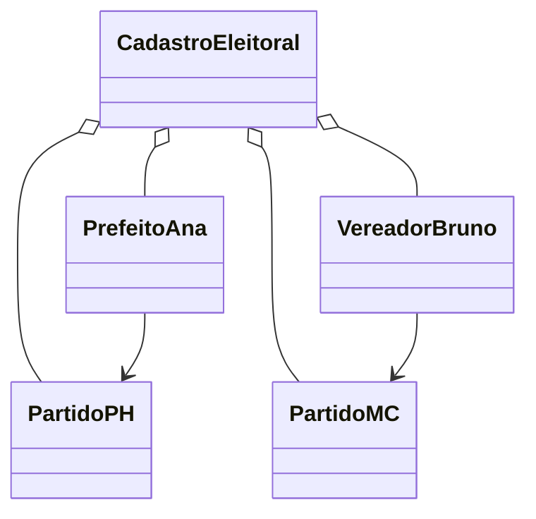

# 7. Cadastro de dois tipos de candidatos

Esta parte acompanha uma execução completa, desde a criação dos partidos até o cadastro de um candidato a prefeito e um candidato a vereador. O objetivo é relacionar as entradas do terminal aos objetos criados em memória.

## Preparação: cadastrar os partidos

Escolha a opção `1` e informe dados fictícios:

```text
Nome do partido: Partido Horizonte
Sigla: PH
```

Repita a operação:

```text
Nome do partido: Movimento Cidadão
Sigla: MC
```

Internamente, cada operação cria um objeto:

```java
new Partido("Partido Horizonte", "PH");
new Partido("Movimento Cidadão", "MC");
```

Os objetos são adicionados à lista `partidos` de `CadastroEleitoral`.

## Cadastro de candidato a prefeito

Escolha a opção `3`, selecione o tipo `1` e informe:

```text
Nome do candidato: Ana Silva
Número: 25
Partido: 1
Nome do vice: Carlos Souza
```

O trecho correspondente cria:

```java
Candidato candidato = new CandidatoPrefeito(
    "Ana Silva",
    "25",
    partido,
    "Carlos Souza"
);
```

Durante essa construção:

1. `new` reserva e inicializa o objeto;
2. o construtor de `CandidatoPrefeito` recebe quatro argumentos;
3. `super(nome, numero, partido)` chama o construtor de `Candidato`;
4. a superclasse valida nome, número e partido;
5. a subclasse verifica se o número possui dois dígitos;
6. a subclasse valida e armazena o nome do vice;
7. o objeto é enviado a `cadastrarCandidato()`.

## Cadastro de candidato a vereador

Escolha novamente a opção `3`, selecione o tipo `2` e informe:

```text
Nome do candidato: Bruno Lima
Número: 25123
Partido: 2
Bairro prioritário: Centro
```

O objeto correspondente é:

```java
Candidato candidato = new CandidatoVereador(
    "Bruno Lima",
    "25123",
    partido,
    "Centro"
);
```

As etapas comuns são realizadas por `Candidato`. A validação dos cinco dígitos e do bairro é realizada por `CandidatoVereador`.

## Estado das listas após os cadastros



A lista foi declarada como `List<Candidato>`, mas contém objetos de duas subclasses diferentes.

## Testes de validação

### Número de prefeito incorreto

```text
Número: 251
```

Resultado esperado:

```text
O número de prefeito deve possuir exatamente 2 dígitos.
```

### Número de vereador incorreto

```text
Número: 25
```

Resultado esperado:

```text
O número de vereador deve possuir exatamente 5 dígitos.
```

### Número com letras

```text
Número: 25A12
```

A classe `Candidato` rejeita o valor porque o número deve conter somente dígitos.

### Número repetido

Ao tentar cadastrar outro candidato com um número já existente, `CadastroEleitoral` percorre a lista e interrompe a inclusão.

## Objeto, referência e tipo

Nesta declaração:

```java
Candidato candidato = new CandidatoPrefeito(...);
```

- `Candidato` é o tipo da referência;
- `candidato` é a variável;
- `CandidatoPrefeito` é a classe concreta do objeto;
- `new` realiza a instanciação.

O fato de a referência ser geral não altera a classe real do objeto.

## Verificação de aprendizagem

1. Quais construtores são executados ao criar `CandidatoPrefeito`?
2. Qual classe verifica se o número contém apenas dígitos?
3. Qual classe verifica a quantidade de dígitos?
4. Por que o partido precisa existir antes do candidato?
5. Quais objetos ficam armazenados em `List<Candidato>`?

